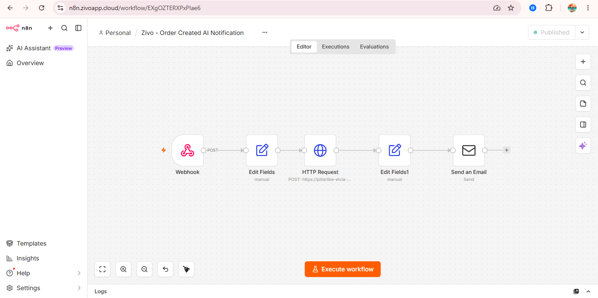
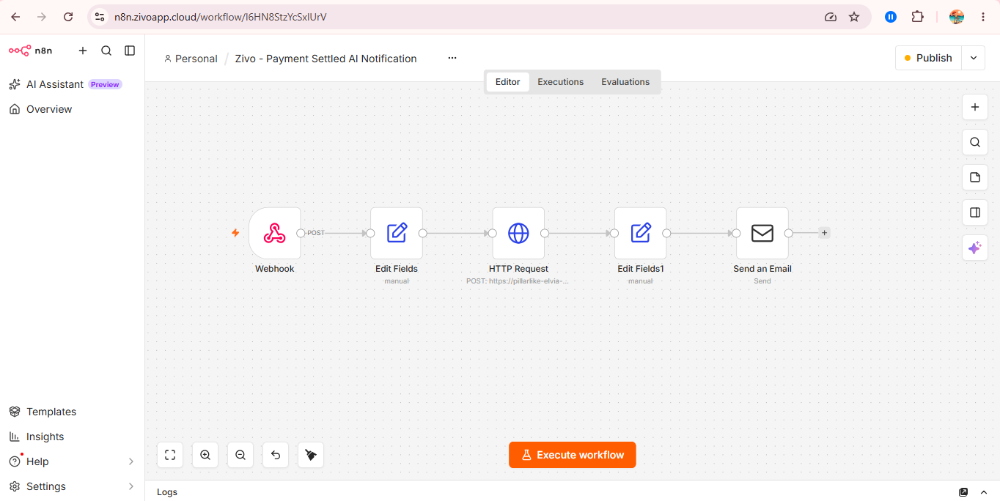
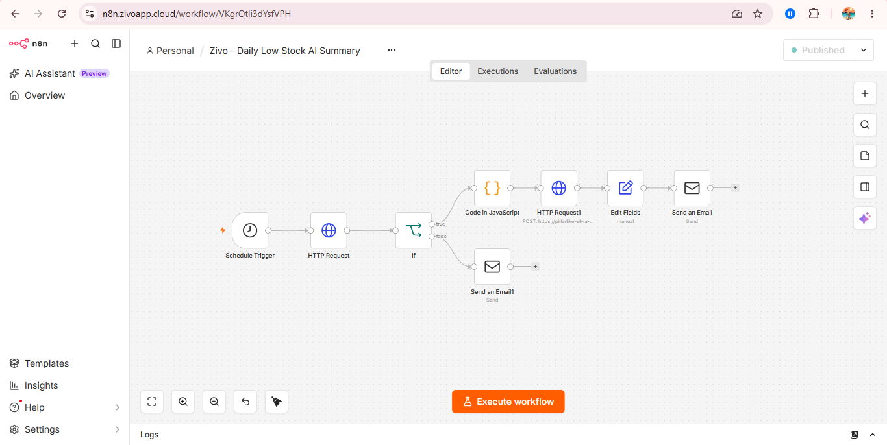

# 🛒 Zivo

A full-stack mini e-commerce application built with Laravel 12 and Angular 21 .

Zivo started as a project to practice full-stack development and gradually evolved into a more complete e-commerce system. The application focuses not only on UI development, but also on real-world backend concerns such as authentication, authorization, checkout, stock management, payment processing, data consistency, automation, and AI integration.

The project uses a Service Layer architecture, PostgreSQL, Angular Signals, Midtrans, RajaOngkir, n8n, Docker, and Ollama.


## 🚀 Live Demo

| Service | Link |
|---------|------|
| 🌐 Frontend | https://zivo-front-end.vercel.app |
| ⚙️ Backend API | https://api.zivoapp.cloud |
| 💻 Frontend Repository | https://github.com/DefanZp/Zivo-frontEnd |
| 🔧 Backend Repository | https://github.com/DefanZp/Zivo-backEnd |
| 🤖 n8n Repository | https://github.com/DefanZp/Zivo-n8n |


## 🔐 Demo Account

Use the following account to try out Zivo's features.

### 👤 Customer

| Field | Credential |
|------|------------|
| Email | `demo.user@zivo.com` |
| Password | `ZivoUser123!` |

### 🛠️ Admin

| Field | Credential |
|------|------------|
| Email | `demo.admin@zivo.com` |
| Password | `ZivoAdmin123!` |

> These accounts are provided only for demonstration purposes.


## 📖 About The Project

Zivo is a full-stack e-commerce application built as a portfolio project.

Customers can browse and search products, filter products by category, manage their cart, manage delivery addresses, calculate shipping costs, place orders, complete payments, and track their order history.

The application also includes an admin panel for managing products, monitoring orders, viewing sales statistics, and updating order statuses.

Beyond the core e-commerce flow, Zivo also integrates automation and AI using n8n and Ollama. Important application events such as order creation, successful payment, and low-stock products can trigger automated workflows and email notifications.

The backend is built with Laravel 12 and handles REST APIs, authentication, authorization, order processing, stock management, payment logic, image processing, and integrations with external services.

The frontend is built with Angular 21 and uses Angular Signals for application state management.

The project follows a Service Layer architecture to keep business logic separated from HTTP controllers and make the application easier to maintain and extend.

## ⭐ Project Highlights

- Full-stack architecture using Angular and Laravel.
- Service Layer architecture for backend business logic.
- PostgreSQL database with transactional order processing.
- Midtrans payment integration with webhook verification.
- RajaOngkir shipping integration.
- Image optimization using WebP and automatic resizing.
- n8n-based event automation.
- AI-assisted workflows using Ollama.
- Dockerized production environment.
- VPS deployment with Nginx and HTTPS.
- GitHub Actions-based deployment workflow.

## ✨ Features

### 👤 Customer Features

- 🔐 Register and Login using Laravel Sanctum.
- 🛍️ Browse products with pagination.
- 🔍 Search products by name.
- 🏷️ Filter products by category.
- ↕️ Sort products by newest, price, or name.
- 📦 View product details.
- 🛒 Add and manage products in the shopping cart.
- 📍 Manage multiple delivery addresses.
- ⭐ Set a default delivery address.
- 💳 Checkout using a selected delivery address.
- 📦 Create orders from cart items.
- 📋 View order history with pagination.
- 🔎 View order details.
- 📍 View shipping information stored with the order.
- 📈 Track order status through an order timeline.

### 🛠️ Administrator Features

- 📊 Dashboard with sales statistics.
- 💰 Revenue summary from completed orders.
- 📦 Product management (Create, Read, Update, Delete).
- 🖼️ Product image upload with automatic resizing and WebP conversion.
- 📋 View customer orders.
- 🔎 View order details.
- 🔄 Update order status with business rules.
- 💳 View payment information.
- 🔄 Update payment status.
- 📦 Monitor low-stock products.
- 🔐 Protected admin routes.

---

## 📦 Order & Checkout

The checkout process is handled by the backend to ensure that important business rules are not trusted to the frontend.

When an order is created, the backend:

1. Validates that the selected address belongs to the authenticated user.
2. Locks the related products before checking stock.
3. Checks product availability.
4. Calculates the order total using the current product price.
5. Creates the order and order items.
6. Reduces product stock.
7. Creates the related payment record.
8. Commits the operation inside a database transaction.

This helps keep the order creation process consistent when an error occurs.

---

## 📍 Address Snapshot

Zivo uses an **address snapshot** when an order is created.

Instead of relying only on the customer's current address, the address information is copied into the order at checkout.

```text
Customer Address
       ↓
    Checkout
       ↓
Order Address Snapshot
```

This means changing a customer's address later will not change the shipping information stored in an existing order.

---

## 📦 Stock Management

Stock is handled as part of the order business logic.

When an order is created:

```text
Current Stock
      -
Order Quantity
      =
New Stock
```

Products are locked using `lockForUpdate()` while the order is being processed.

This helps prevent inconsistent stock when multiple requests try to purchase the same product at the same time.

When an order is cancelled, the stock is restored through the cancellation flow.

Stock restoration is handled in one place to avoid restoring the same stock multiple times.

---

# 💳 Payment Flow

Zivo uses Midtrans as its payment gateway and integrates payment status with the order lifecycle.

When an order is created:

Order → Payment → unpaid

The customer can open the Midtrans Snap payment page directly from checkout or later from the order detail page using Pay Now.

## Payment Flow Diagram

```text
Checkout
   ↓
Create Order
   ↓
Create Payment
   ↓
Clear Cart
   ↓
Midtrans Snap
   ↓
Customer Payment
   ↓
Midtrans Webhook
   ↓
Update Payment
   ↓
Update Order
```

## Supported Payment States

Zivo maps Midtrans transaction statuses to its own payment states:

Midtrans              Zivo
----------------------------
pending         →     unpaid
settlement      →     paid
capture         →     paid
expire          →     expired
cancel          →     failed
deny            →     failed

### State Transition Rules

When a payment becomes paid:
Payment (paid) → Order (processing)

When an unpaid payment expires:
Payment (expired) → Order cancelled → Stock restored

## Payment Security & Consistency

- Payment notifications are verified using Midtrans's signature.
- Payment notifications are processed through database transactions.
- Payment and order records are locked when handling sensitive status changes.
- Customers can only access their own payments.
- Completed or expired payments cannot be processed again.
- Existing Midtrans transactions are checked before creating a new Snap transaction to prevent duplicate payment transactions.
- Customers can reopen an unpaid payment from the Order Detail page using Pay Now.
- Payment status is controlled by the payment gateway and webhook flow, while order status follows Zivo's business rules.

---

## 🔄 Order Status Rules

Order status is controlled by business rules instead of allowing arbitrary status changes.

Current transitions:

```text
pending
 ├── processing
 └── cancelled

processing
 ├── completed
 └── cancelled

completed
 └── cannot be changed

cancelled
 └── cannot be changed
```

`pending → processing` is only allowed when the related payment has been successfully paid.

This prevents invalid transitions such as:

```text
pending → completed
processing → pending
completed → cancelled
cancelled → processing
```

---

## 🤖 AI & Automation

Zivo uses n8n as an automation layer to connect the Laravel backend with AI-powered workflows and email notifications.

### 1. Order Created → Admin Notification

When a customer creates an order, Laravel sends an event to an n8n webhook.

```text
Laravel
   ↓
n8n Webhook
   ↓
Ollama
   ↓
Email to Admin
```

The workflow processes the order data and uses AI to generate the notification content.

### 2. Payment Settled → Customer Notification

When a payment is successfully settled, Laravel processes the Midtrans notification and triggers an n8n workflow.

```text
Midtrans
   ↓
Laravel
   ↓
n8n Webhook
   ↓
Ollama
   ↓
Email to Customer
```

The AI model is only responsible for generating the message wording, while transaction information such as order ID, payment status, and total price comes directly from Laravel.

### 3. Daily Low Stock AI Summary

A scheduled n8n workflow checks the Laravel API every morning for products below the low-stock threshold.

```text
Schedule Trigger
      ↓
Laravel Low Stock API
      ↓
IF
      ↓
Ollama
      ↓
Email
```

The workflow generates a short AI-assisted summary of products that require attention.

### AI Model

AI generation is handled using Ollama with the `qwen2.5:1.5b` model. The AI is used for wording and summarization while important business data remains controlled by the Laravel backend.

---

## 🖼️ Product Image Optimization

Zivo uses an optimized image pipeline for product images.

### Admin Upload

```text
Image Upload
     ↓
Validation
     ↓
Resize to maximum 1200px
     ↓
Convert to WebP
     ↓
Store in Product Storage
     ↓
Save image_path
```

The database stores only the image path, while the `image_url` attribute is generated by the Product model accessor.

Example:

```text
image_path
→ products/product_xxxxx.webp

image_url
→ https://api.zivoapp.cloud/storage/products/product_xxxxx.webp
```

Product images on the frontend use lazy loading to reduce unnecessary network requests.

## 🧱 Architecture

### Backend

The Laravel backend follows a Service Layer structure:

```text
Route
  ↓
Controller
  ↓
Service
  ↓
Model
  ↓
Database
```

Controllers handle HTTP requests and responses, while business logic is placed inside services.

Examples:

- `OrderService`
- `PaymentService`
- `ProductService`

---

### Frontend

The Angular application follows a similar separation:

```text
Component
   ↓
Service
   ↓
HttpClient
   ↓
Laravel API
```

Angular Signals are used for application state where appropriate.

Examples include:

- Authentication
- Products
- Cart
- Addresses
- Orders
- Loading states
- Selected data

### Automation & Integration

```text
Laravel
   │
   ├── Midtrans
   │      ↓
   │   Payment Webhook
   │
   └── n8n
          ↓
       Ollama
          ↓
        Email
```

### Production Infrastructure

```text
Cloudflare
     ↓
    VPS
     │
     ├── Nginx
     ├── Laravel
     ├── Queue
     ├── PostgreSQL
     └── n8n
```

The application services are containerized using Docker and deployed on a VPS.

---

## 🛠 Tech Stack

| Layer | Technology |
|-------|------------|
| Frontend | Angular 21 |
| Backend | Laravel 12 |
| Language | PHP 8.2+ |
| Database | PostgreSQL 17 |
| Authentication | Laravel Sanctum |
| Styling | Tailwind CSS |
| State Management | Angular Signals |
| ORM | Eloquent ORM |
| API Architecture | REST API |
| Payment | Midtrans |
| Shipping | RajaOngkir |
| Image Processing | Intervention Image |
| Automation | n8n |
| AI | Ollama |
| Containerization | Docker / Docker Compose |
| Reverse Proxy | Nginx |
| Deployment | Vercel + VPS |
| CI/CD | GitHub Actions |
| API Testing | Thunder Client |

---

## 🧠 Technical Decisions

### Service Layer

Business logic is separated from controllers using the Service Layer pattern.

This is especially useful for:

- Checkout
- Order creation
- Stock management
- Payment processing
- Order cancellation

### PostgreSQL

PostgreSQL is used as the production database.


### Database Transactions

Transactions are used when multiple database changes need to succeed or fail together.

For example:

```text
Create Order
    +
Create Order Items
    +
Reduce Stock
    +
Create Payment
```

### Concurrency Handling

`lockForUpdate()` is used when processing products and updating sensitive order and payment data.

This helps prevent inconsistent results when multiple requests happen at the same time.

### Image Optimization

Product images are resized and converted to WebP before being stored.

This reduces image size while maintaining sufficient quality for product listings and detail pages.

### Automation with n8n

n8n is used as a separate automation layer instead of putting notification logic directly inside frontend components.

This keeps event-driven workflows separate from the main application logic.

### AI-assisted Content

AI is used for generating notification wording and summaries, while critical business data remains controlled by the Laravel backend.

This prevents AI-generated text from becoming the source of truth for transaction data.


## 🗂️ Main Frontend Routes

```text
/
├── products
├── products?category=:slug
├── product/:id
├── cart
├── checkout
│
├── user/settings
├── user/settings/addresses
├── user/settings/payment
├── user/orders
├── user/orders/:id
│
├── admin/dashboard
├── admin/products
├── admin/products/create
├── admin/products/:id/edit
├── admin/orders
├── admin/orders/:id
│
└── payment/result
```

Authentication and admin access are protected using Angular route guards.

---

## 👤 Customer Experience

### 📦 Product List


---

### 📄 Product Detail


---

### 🛒 Shopping Cart


---

### 💳 Checkout


---

### 📋 Order history


---

### 🔎 Order detail


---

### 👤 Account profile


---

### 📍 Account address


---

### ➕ Add address


---

### ✏️ Edit address


---

### 🔐 Login


---

### 📝 Register


---

## 🛠 Administrator Dashboard

### 📊 Dashboard


---

### 📦 Product Management


---

### ➕ Create Product


---

### ✏️ Edit Product


---

### 📋 Order Management


---

### 📋 Order Detail


---

## 🤖 Automation Workflows

### 📦 Order Created



---

### 💳 Payment Settled



---

### 📉 Daily Low Stock



---

## 📦 Source Code

| Repository | Description |
|------------|-------------|
| https://github.com/DefanZp/Zivo-frontEnd | Angular 21 Frontend |
| https://github.com/DefanZp/Zivo-backEnd | Laravel 12 REST API |

---

## ⚙️ Installation

Clone both repositories.

### Backend

```bash
git clone https://github.com/DefanZp/Zivo-backEnd
```

### Frontend

```bash
git clone https://github.com/DefanZp/Zivo-frontEnd
```

Follow the README in each repository for environment setup and installation instructions.

---

## 🚧 Future Improvements

The core e-commerce, payment, automation, and AI workflows are currently implemented.

Possible future improvements include:

- ❤️ Wishlist functionality
- 🧪 Increase automated test coverage
- 📱 Further improve responsive and mobile UX
- 📊 Add more monitoring and observability
- ⚙️ Further improve deployment automation

---