# 🛒 Zivo

A full-stack mini e-commerce application built with Laravel 12 and Angular 21 .

Designed to demonstrate modern full-stack web development using RESTful APIs, Service Layer architecture, PostgreSQL.


## 🚀 Live Demo

| Service | Link |
|---------|------|
| 🌐 Frontend | https://zivo-front-end.vercel.app |
| ⚙️ Backend API | https://zivo-backend-production-6c97.up.railway.app |
| 💻 Frontend Repository | https://github.com/DefanZp/Zivo-frontEnd |
| 🔧 Backend Repository | https://github.com/DefanZp/Zivo-backEnd |

## 📖 About The Project

Zivo is a full-stack e-commerce web application developed as a portfolio project to demonstrate modern web development practices.

The application allows customers to browse products, search, filter, manage their shopping cart, and place orders. It also includes an admin panel for managing products and monitoring customer orders.

The backend is built with Laravel 12 using the Service Layer pattern and Laravel Sanctum for authentication, while the frontend is developed using Angular 21  with Angular Signals for state management. PostgreSQL is used as the database, and the application is deployed on Railway and Vercel.

## ✨ Features

### 👤 Customer Features

- 🔐 Register and Login securely using Laravel Sanctum authentication.
- 🛍️ Browse products with pagination.
- 🔍 Search products by name.
- 🏷️ Filter products by category.
- ↕️ Sort products by newest, price, or name.
- 📦 View detailed product information.
- 🛒 Add and manage products in the shopping cart.
- 💳 Checkout with shipping information.

---

### 🛠️ Administrator Features

- 📊 Dashboard with sales statistics.
- 📈 Revenue summary.
- 📦 Product management (Create, Read, Update, Delete).
- 📋 Order management.
- 🔄 Update customer order status.

## 🛠 Tech Stack

| Layer | Technology |
|--------|------------|
| Frontend | Angular 21  |
| Backend | Laravel 12 |
| Database | PostgreSQL |
| Authentication | Laravel Sanctum |
| Styling | Tailwind CSS |
| State Management | Angular Signals |
| ORM | Eloquent ORM |
| Deployment | Vercel & Railway |

## 📦 Source Code

| Repository | Description |
|------------|-------------|
| https://github.com/DefanZp/Zivo-frontEnd | Angular 21 |
| https://github.com/DefanZp/Zivo-backEnd | Laravel 12 REST API |

## ⚙️ Installation

Clone both repositories.

### Backend

```bash
git clone https://github.com/DefanZp/Zivo-backEnd
```

### Frontend

```bash
git clone https://github.com/DefanZp/Zivo-frontEnd
```

Follow each repository's README for installation instructions.

## 🚀 Future Improvements

- Wishlist feature.
- Online payment gateway integration.
- Email notifications.
- Product image upload.
- Responsive mobile optimization.

## 👨‍💻 Author

**Defan Zain Pratama**

Frontend Developer → Full Stack Developer

- GitHub: https://github.com/DefanZp
- LinkedIn: www.linkedin.com/in/defan-pratama-320153341


# 👤 Customer Experience

### 📦 Product List

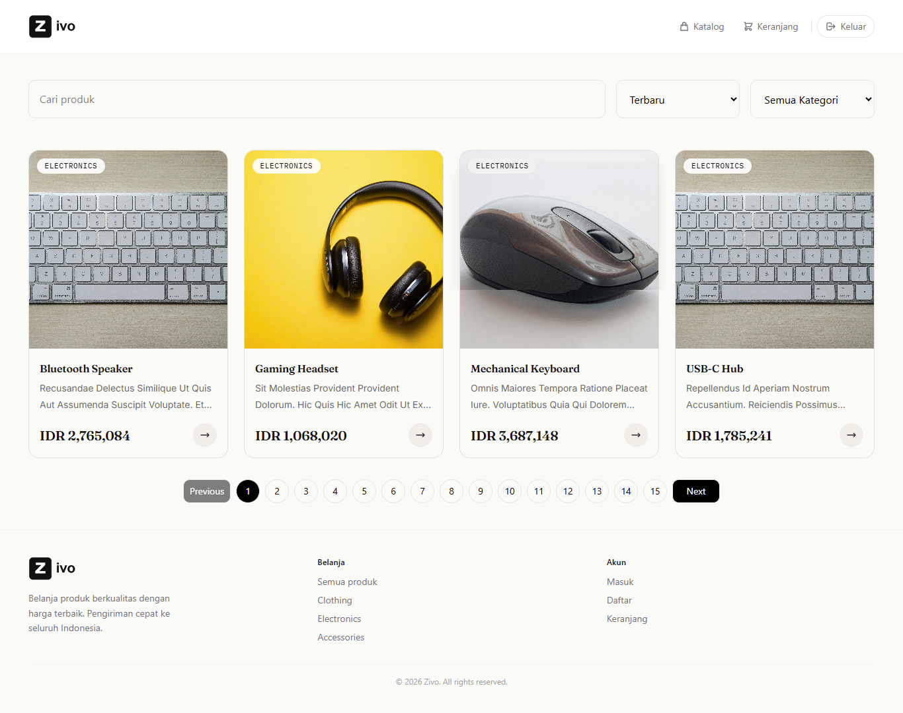

---

### 📄 Product Detail

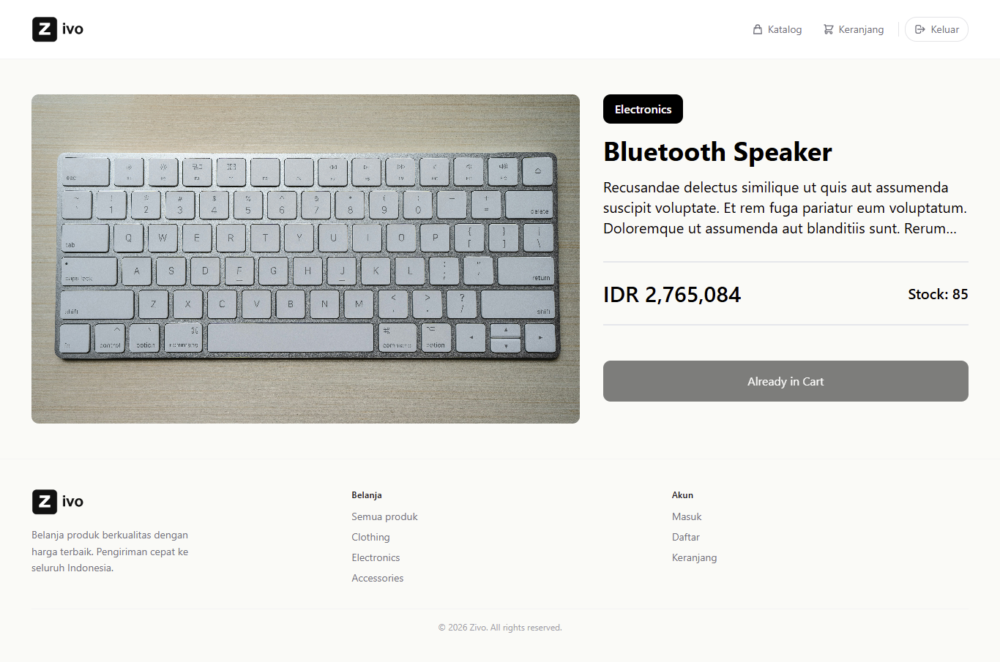

---

### 🛒 Shopping Cart

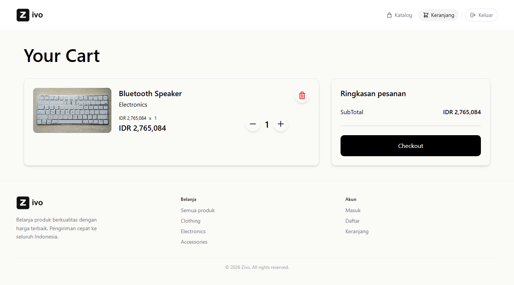

---

### 💳 Checkout

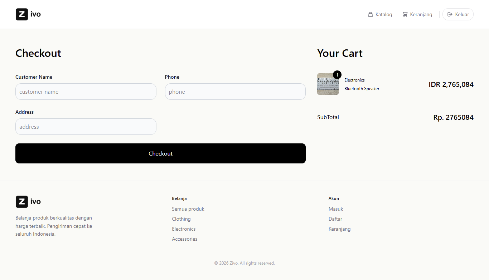

---

### Login

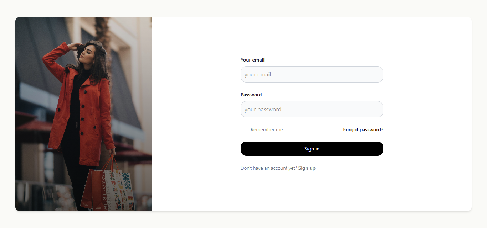

---

### Register

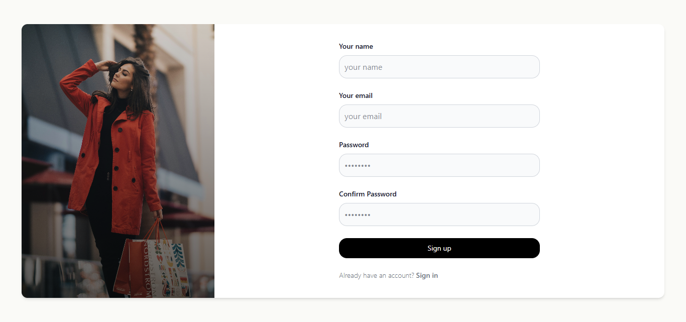


# 🛠 Administrator Dashboard

### 📊 Dashboard

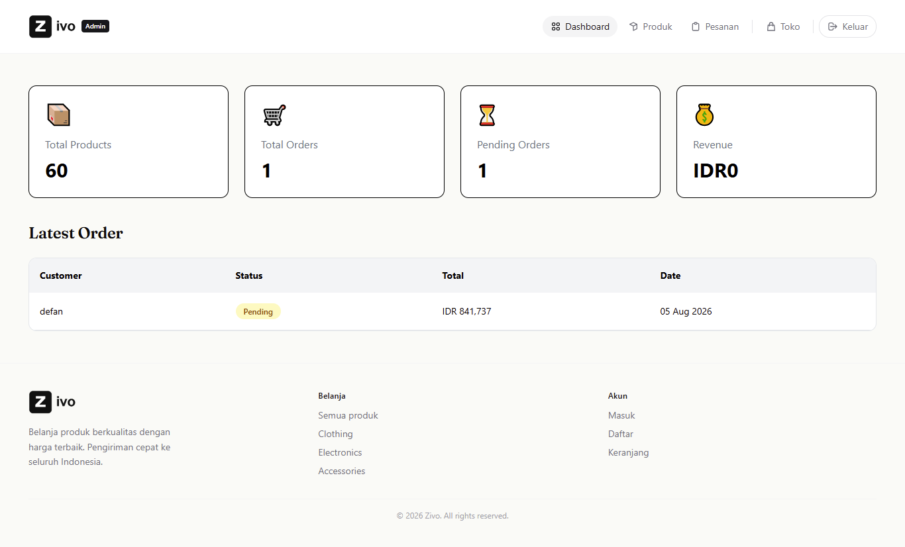

---

### 📦 Product Management

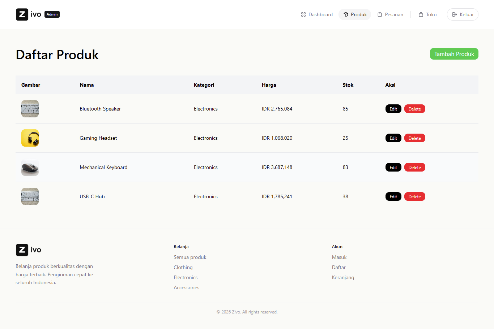

---

### ➕ Create Product

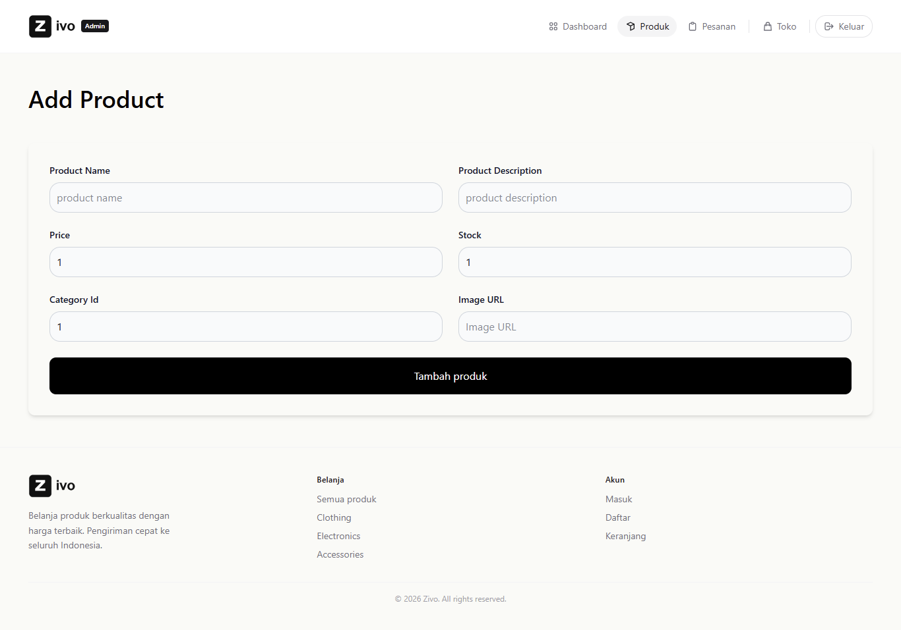

---

### ✏ Edit Product

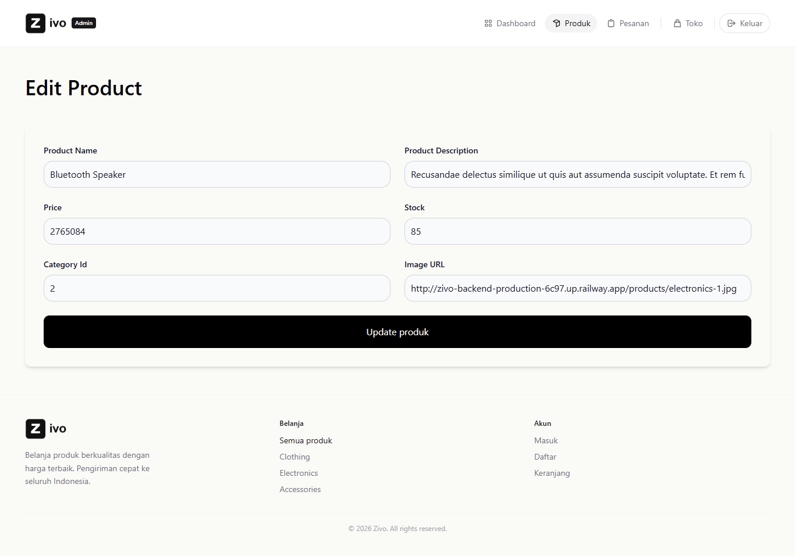

---

### 📋 Order Management

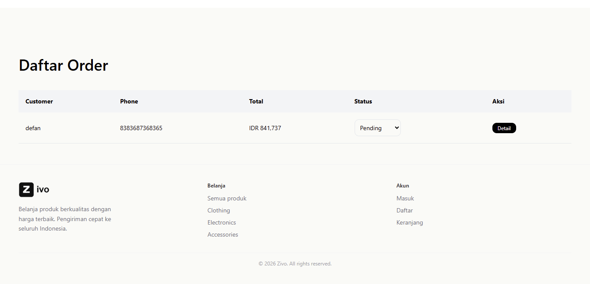

## 💡 Technical Decisions

During development, I chose several architectural approaches to improve maintainability and scalability:

- Implemented the Service Layer pattern to separate business logic from controllers.
- Used Angular Signals for reactive state management instead of RxJS for simpler component state.
- Implemented Laravel Sanctum for secure API authentication.
- Used PostgreSQL as the production database.
- Deployed the backend on Railway and the frontend on Vercel.