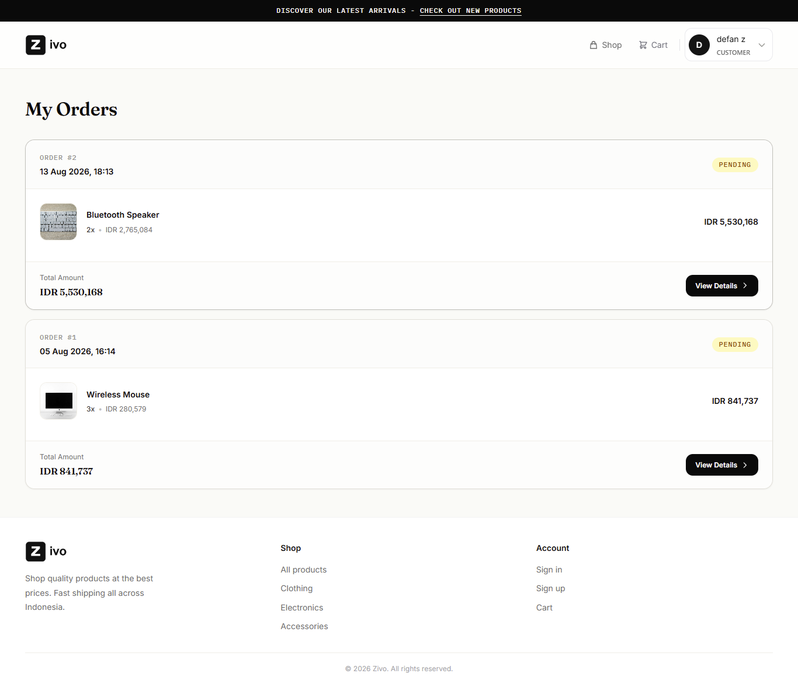
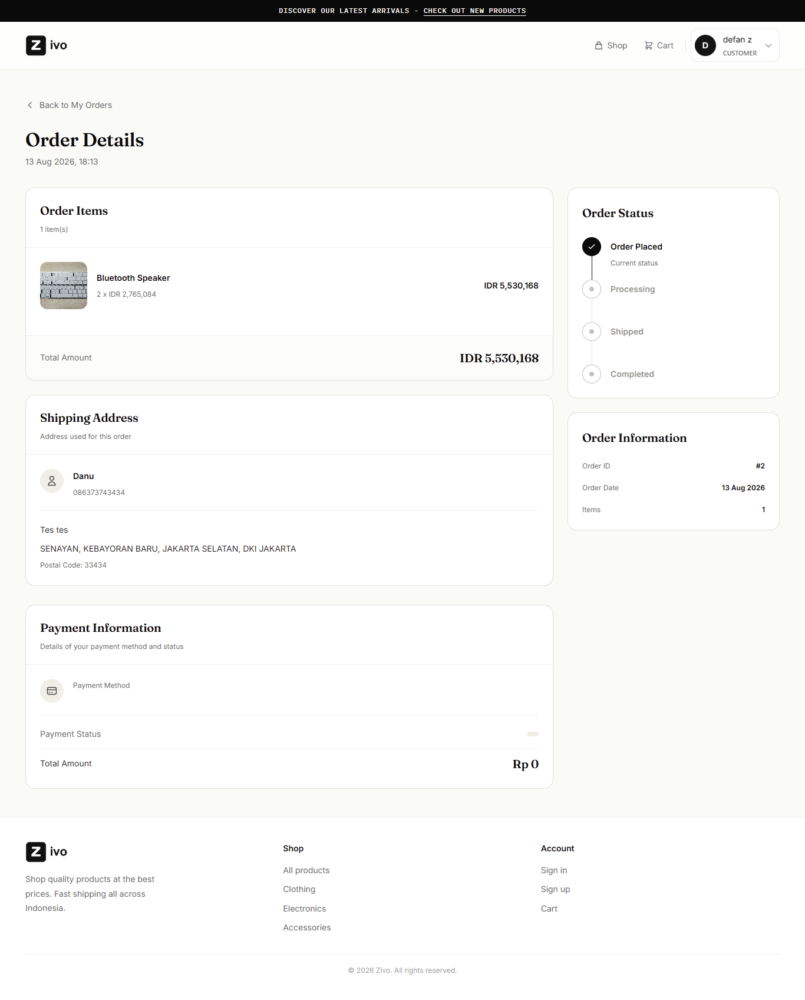
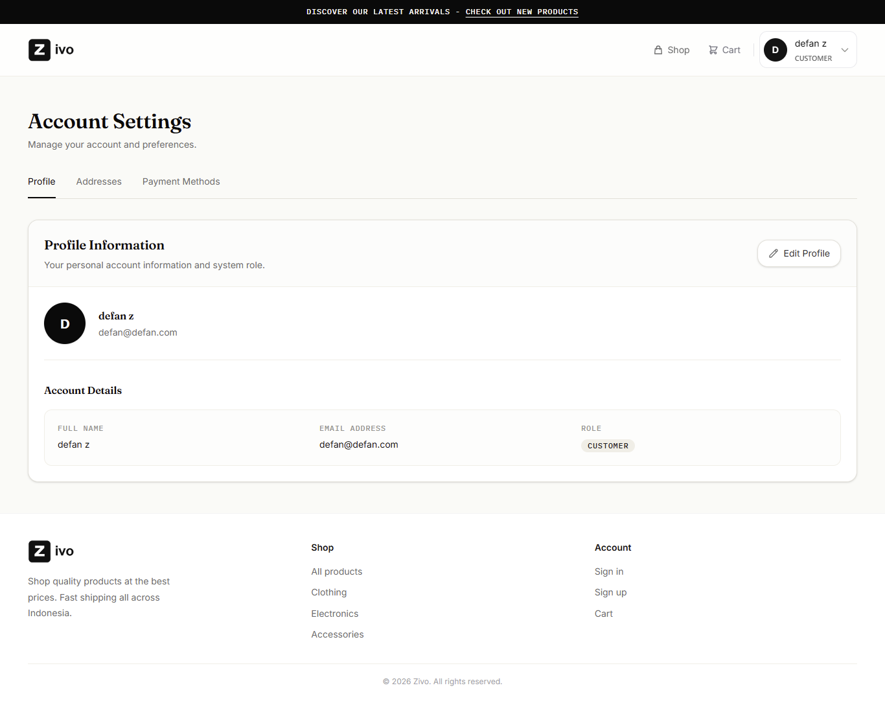
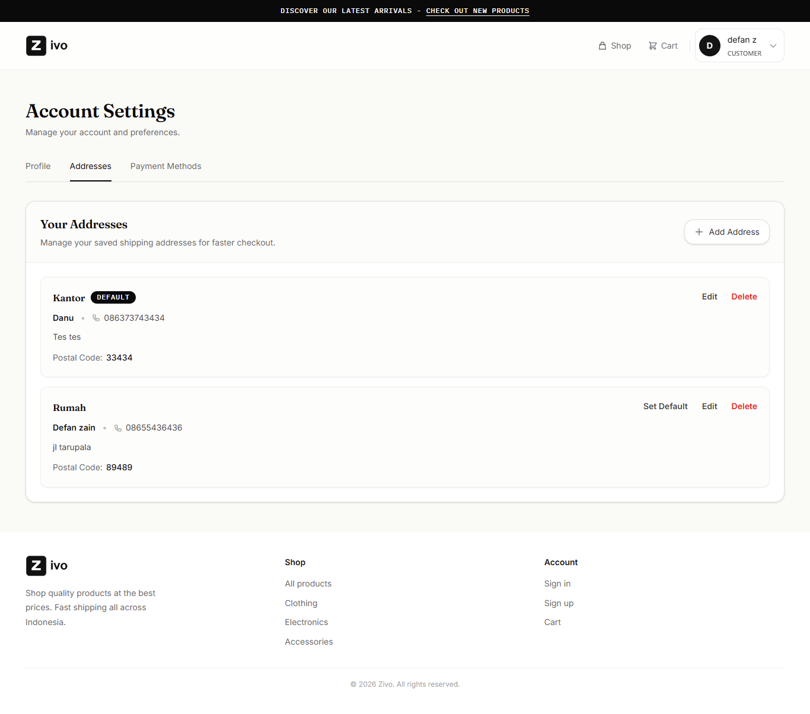
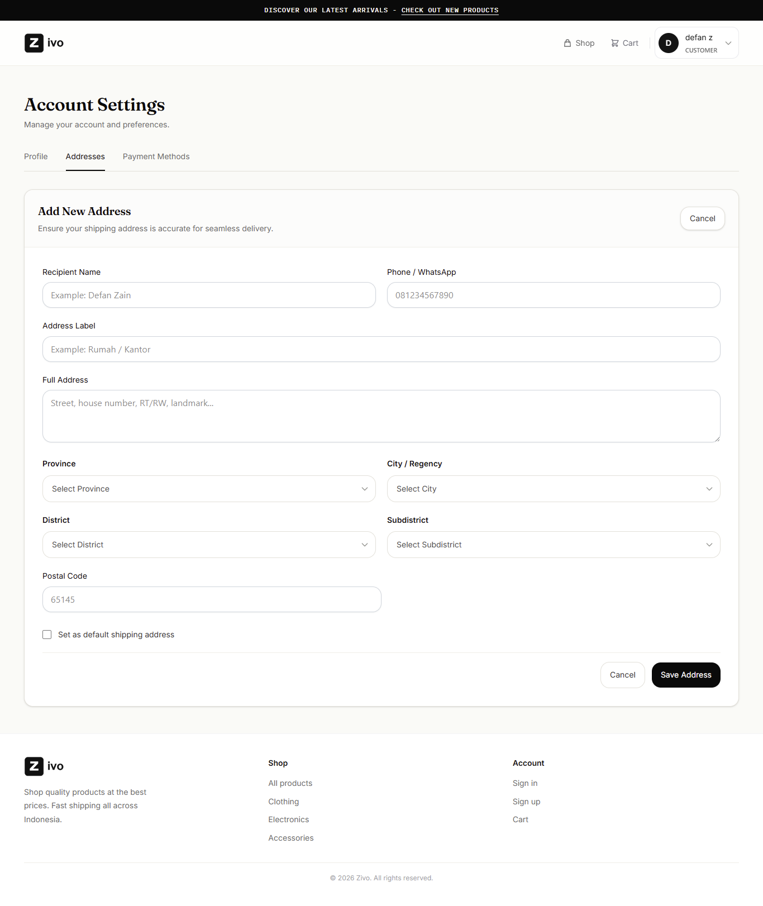
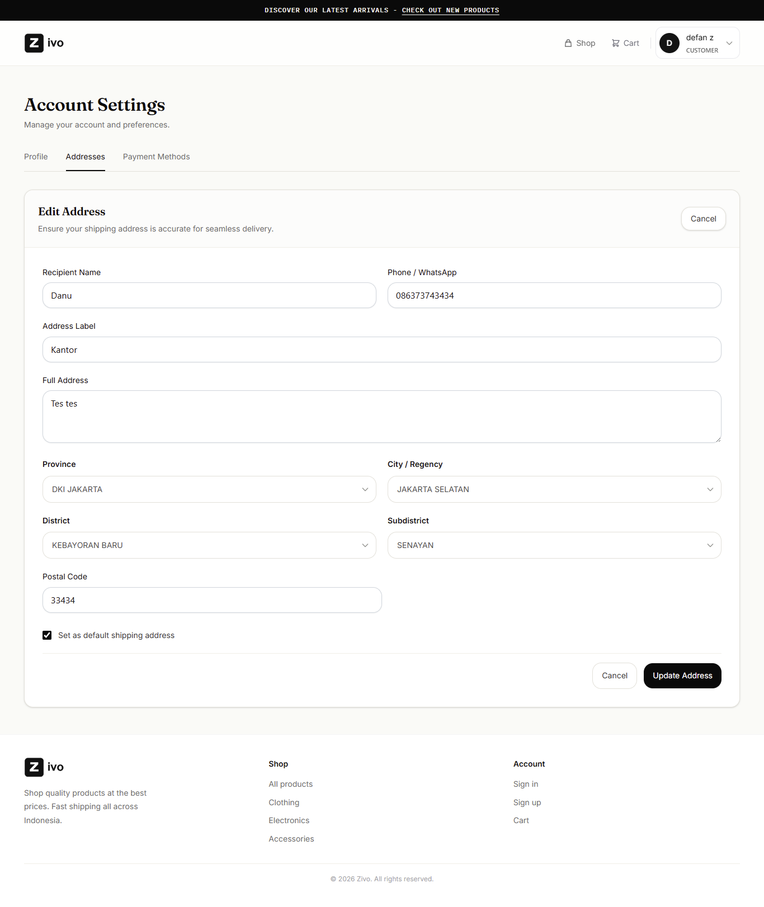
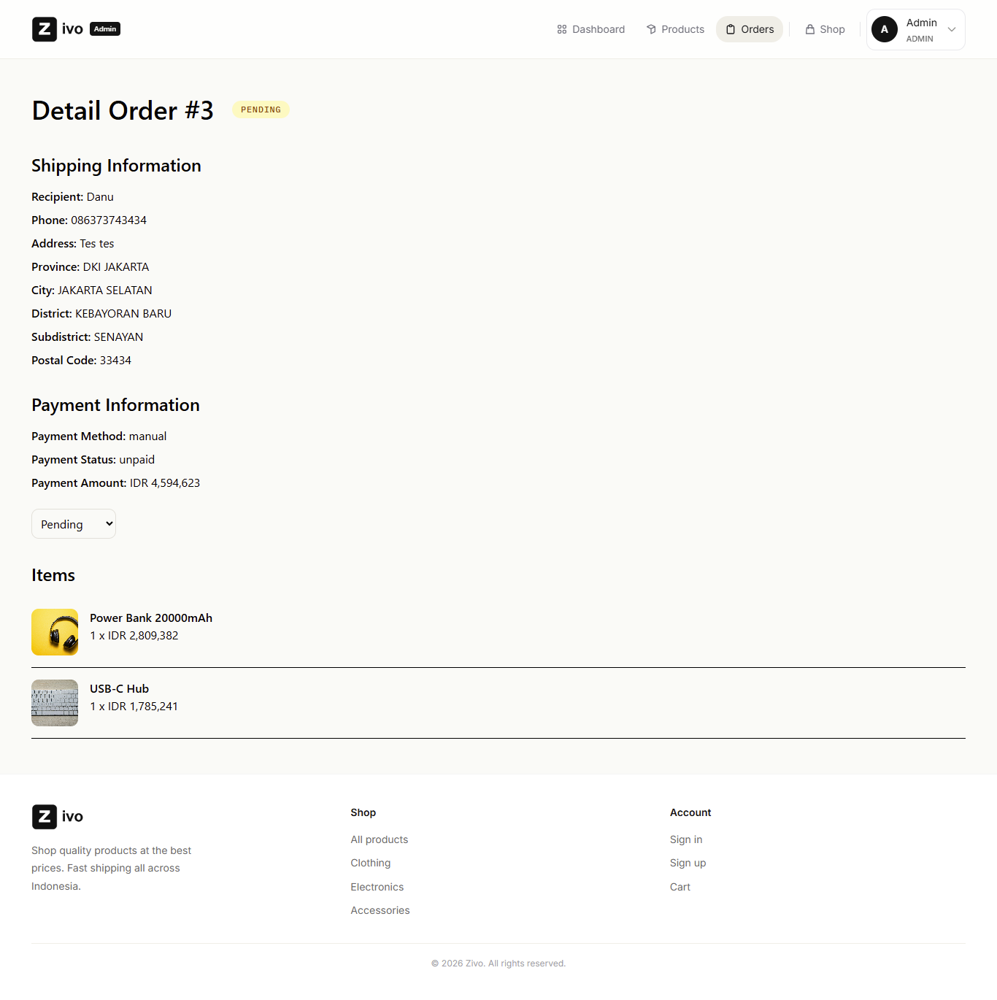

# 🛒 Zivo

A full-stack mini e-commerce application built with Laravel 12 and Angular 21 .

Zivo started as a project to practice full-stack development and gradually grew into a more complete e-commerce application. The focus is not only on building the UI, but also on handling real application logic such as authentication, authorization, checkout, stock management, order processing, payment status, and data consistency.

The project uses a Service Layer architecture, PostgreSQL, Angular Signals, and is deployed using Railway and Vercel.


## 🚀 Live Demo

| Service | Link |
|---------|------|
| 🌐 Frontend | https://zivo-front-end.vercel.app |
| ⚙️ Backend API | https://zivo-backend-production-6c97.up.railway.app |
| 💻 Frontend Repository | https://github.com/DefanZp/Zivo-frontEnd |
| 🔧 Backend Repository | https://github.com/DefanZp/Zivo-backEnd |


## 🔐 Demo Account

Gunakan akun berikut untuk mencoba fitur Zivo.

### 👤 Customer

| Field | Credential |
|------|------------|
| Email | `demo.user@zivo.com` |
| Password | `ZivoUser123!` |

### 🛠️ Admin

| Field | Credential |
|------|------------|
| Email | `demo.admin@zivo.com` |
| Password | `ZivoAdmin123!` |

> These accounts are provided only for demonstration purposes.


## 📖 About The Project

Zivo is a full-stack e-commerce application built as a portfolio project.

Customers can browse and search products, manage their cart, manage delivery addresses, place orders, and track their order history.

The application also includes an admin panel for managing products, monitoring orders, viewing sales statistics, and updating order statuses.

On the backend, Laravel handles the REST API, authentication, authorization, order processing, stock management, and payment logic. The frontend is built with Angular 21 and uses Angular Signals for application state.

The project is designed around a Service Layer architecture so that business logic stays separated from controllers and can be easier to maintain as the application grows.

## ✨ Features

### 👤 Customer Features

- 🔐 Register and Login using Laravel Sanctum.
- 🛍️ Browse products with pagination.
- 🔍 Search products by name.
- 🏷️ Filter products by category.
- ↕️ Sort products by newest, price, or name.
- 📦 View product details.
- 🛒 Add and manage products in the shopping cart.
- 📍 Manage multiple delivery addresses.
- ⭐ Set a default delivery address.
- 💳 Checkout using a selected delivery address.
- 📦 Create orders from cart items.
- 📋 View order history with pagination.
- 🔎 View order details.
- 📍 View shipping information stored with the order.
- 📈 Track order status through an order timeline.

### 🛠️ Administrator Features

- 📊 Dashboard with sales statistics.
- 💰 Revenue summary from completed orders.
- 📦 Product management (Create, Read, Update, Delete).
- 📋 View customer orders.
- 🔎 View order details.
- 🔄 Update order status with business rules.
- 💳 View payment information.
- 🔄 Update payment status.
- 🔐 Protected admin routes.

---

## 📦 Order & Checkout

The checkout process is handled by the backend to ensure that important business rules are not trusted to the frontend.

When an order is created, the backend:

1. Validates that the selected address belongs to the authenticated user.
2. Locks the related products before checking stock.
3. Checks product availability.
4. Calculates the order total using the current product price.
5. Creates the order and order items.
6. Reduces product stock.
7. Creates the related payment record.
8. Commits the operation inside a database transaction.

This helps keep the order creation process consistent when an error occurs.

---

## 📍 Address Snapshot

Zivo uses an **address snapshot** when an order is created.

Instead of relying only on the customer's current address, the address information is copied into the order at checkout.

```text
Customer Address
       ↓
    Checkout
       ↓
Order Address Snapshot
```

This means changing a customer's address later will not change the shipping information stored in an existing order.

---

## 📦 Stock Management

Stock is handled as part of the order business logic.

When an order is created:

```text
Current Stock
      -
Order Quantity
      =
New Stock
```

Products are locked using `lockForUpdate()` while the order is being processed.

This helps prevent inconsistent stock when multiple requests try to purchase the same product at the same time.

When an order is cancelled, the stock is restored through the cancellation flow.

Stock restoration is handled in one place to avoid restoring the same stock multiple times.

---

## 💳 Payment Flow

The project currently has a payment flow connected to the order lifecycle.

When an order is created:

```text
Order
  ↓
Payment
  ↓
unpaid
```

Payment status changes are validated by the backend.

Current payment rules include:

```text
unpaid → paid
unpaid → expired

paid    → cannot be changed
expired → cannot be changed
```

When a payment becomes `paid`:

```text
Payment
   ↓
paid
   ↓
Order
   ↓
processing
```

When an unpaid payment expires:

```text
Payment
   ↓
expired
   ↓
Order cancelled
   ↓
Stock restored
```

Payment and order updates are handled using database transactions where needed.

---

## 🔄 Order Status Rules

Order status is controlled by business rules instead of allowing arbitrary status changes.

Current transitions:

```text
pending
 ├── processing
 └── cancelled

processing
 ├── completed
 └── cancelled

completed
 └── cannot be changed

cancelled
 └── cannot be changed
```

`pending → processing` is only allowed when the related payment has been successfully paid.

This prevents invalid transitions such as:

```text
pending → completed
processing → pending
completed → cancelled
cancelled → processing
```

---

## 🧱 Architecture

### Backend

The Laravel backend follows a Service Layer structure:

```text
Route
  ↓
Controller
  ↓
Service
  ↓
Model
  ↓
Database
```

Controllers handle HTTP requests and responses, while business logic is placed inside services.

Examples:

- `OrderService`
- `PaymentService`
- `ProductService`

---

### Frontend

The Angular application follows a similar separation:

```text
Component
   ↓
Service
   ↓
HttpClient
   ↓
Laravel API
```

Angular Signals are used for application state where appropriate.

Examples include:

- Authentication
- Products
- Cart
- Addresses
- Orders
- Loading states
- Selected data

---

## 🛠 Tech Stack

| Layer | Technology |
|--------|------------|
| Frontend | Angular 21 |
| Frontend Rendering | Angular SSR + Hydration |
| Backend | Laravel 12 |
| Language | PHP 8.2+ |
| Database | PostgreSQL 17 |
| Authentication | Laravel Sanctum |
| Styling | Tailwind CSS |
| State Management | Angular Signals |
| ORM | Eloquent ORM |
| API Architecture | REST API |
| API Testing | Thunder Client |
| Deployment | Vercel & Railway |

---

## 🧠 Technical Decisions

### Service Layer

Business logic is separated from controllers using the Service Layer pattern.

This is especially useful for:

- Checkout
- Order creation
- Stock management
- Payment processing
- Order cancellation

### PostgreSQL

PostgreSQL is used as the production database.


### Database Transactions

Transactions are used when multiple database changes need to succeed or fail together.

For example:

```text
Create Order
    +
Create Order Items
    +
Reduce Stock
    +
Create Payment
```

### Concurrency Handling

`lockForUpdate()` is used when processing products and updating sensitive order and payment data.

This helps prevent inconsistent results when multiple requests happen at the same time.


## 🗂️ Main Frontend Routes

```text
/
├── products
├── product/:id
├── cart
├── checkout
│
├── user/settings
├── user/settings/addresses
├── user/settings/payment
├── user/orders
├── user/orders/:id
│
├── admin/dashboard
├── admin/products
├── admin/products/create
├── admin/products/:id/edit
├── admin/orders
└── admin/orders/:id
```

Authentication and admin access are protected using Angular route guards.

---

## 👤 Customer Experience

### 📦 Product List


---

### 📄 Product Detail


---

### 🛒 Shopping Cart


---

### 💳 Checkout


---

### 📋 Order history



---

### 🔎 Order detail



---

### 👤 Account profile



---

### 📍 Account address



---

### ➕ Add address



---

### ✏️ Edit address



---

### 🔐 Login


---

### 📝 Register


---

## 🛠 Administrator Dashboard

### 📊 Dashboard


---

### 📦 Product Management


---

### ➕ Create Product


---

### ✏️ Edit Product


---

### 📋 Order Management


---

### 📋 Order Detail



---

## 📦 Source Code

| Repository | Description |
|------------|-------------|
| https://github.com/DefanZp/Zivo-frontEnd | Angular 21 Frontend |
| https://github.com/DefanZp/Zivo-backEnd | Laravel 12 REST API |

---

## ⚙️ Installation

Clone both repositories.

### Backend

```bash
git clone https://github.com/DefanZp/Zivo-backEnd
```

### Frontend

```bash
git clone https://github.com/DefanZp/Zivo-frontEnd
```

Follow the README in each repository for environment setup and installation instructions.

---

## 🚧 What's Next

The core e-commerce flow is already working. The next stage is focused on making the application more production-ready.

Planned improvements:

- 💳 Integrate Midtrans Snap as the online payment gateway.
- 🔔 Handle payment gateway webhooks.
- 📧 Add email notifications.
- ❤️ Add wishlist functionality.
- 🖼️ Add product image upload.
- 📱 Improve responsive and mobile UX.
- 🔒 Perform an additional security and production review.

The Midtrans integration is currently being prepared in the Sandbox environment.

---